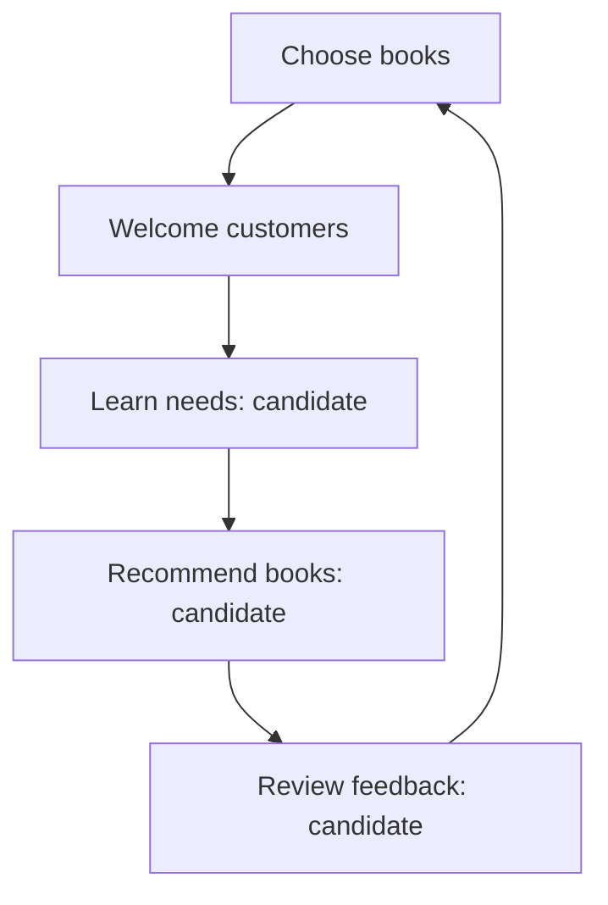
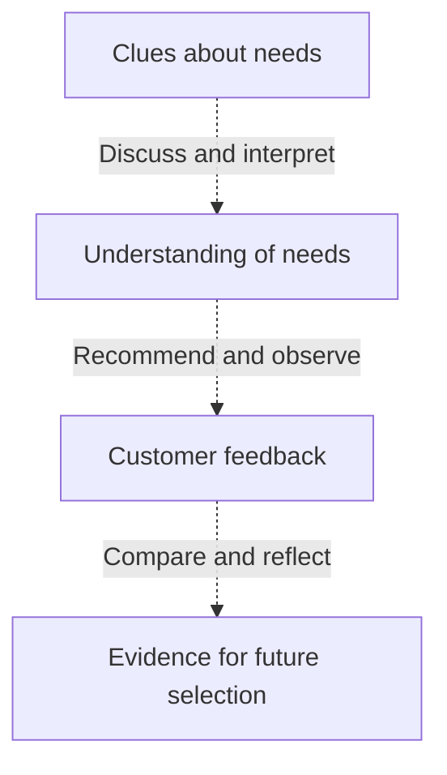

# Fictional example: Night Bookshop
Teaching example, not a complete commercial game design.

Input: run a night bookshop, select books, welcome customers, and aim for warm human connections. No prototype; money, inventory, and time rules are undecided.

## 01 Vision
Run a night bookshop, creating warm human connections through choosing books and welcoming customers.

## 02 Candidate pillars
| Candidate | Practical implication |
| --- | --- |
| Customers are specific people | Understand needs rather than optimizing customer count alone |
| Book selection expresses care | Consider personal circumstances rather than assuming profit is the only goal |
| Leave room for conversation | Examine whether mandatory countdowns undermine the experience |

These are interpretations to discuss, not confirmed rules.

## 03 Proposed loop

Only choosing books and welcoming customers are given actions. Order and other actions remain proposed.

## 04 Resource concept

All relations are candidates. Information may accumulate rather than be consumed. Do not invent currency, stock consumption, time budgets, or endings. Test whether recommendations express care and whether proposed business pressure supports the intended warmth.
