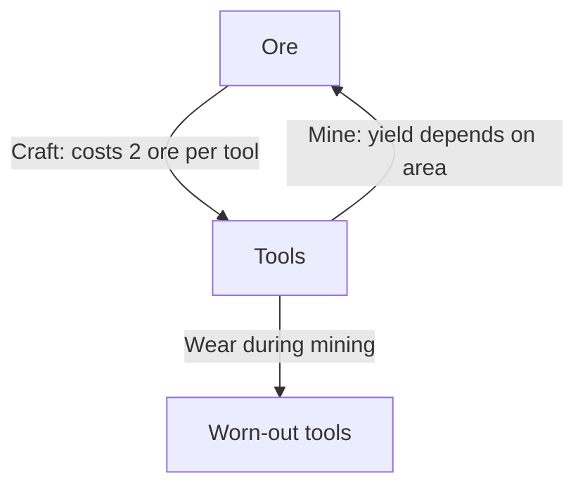

# Fictional example: Resource review
Authored teaching scenario, not an independent skill test.

Given implemented mechanics: spend 2 ore to craft one tool; a tool enables mining and wears out; mining produces ore, with yield depending on the area. The game has no confirmed victory condition. These facts belong only to this example.

The graph reveals a potential reinforcing cycle, but its sign and strength depend on yield, durability, time, access, and other constraints. Do not declare an infinite exploit merely because a cycle exists.
Ask: can expected ore earned before tool failure exceed crafting cost? Does time or area depletion limit growth? If this is intended progression, does it still preserve interesting decisions?
There is no supported victory bottleneck analysis because no victory condition is provided. A complete review needs real parameters and test observations.
