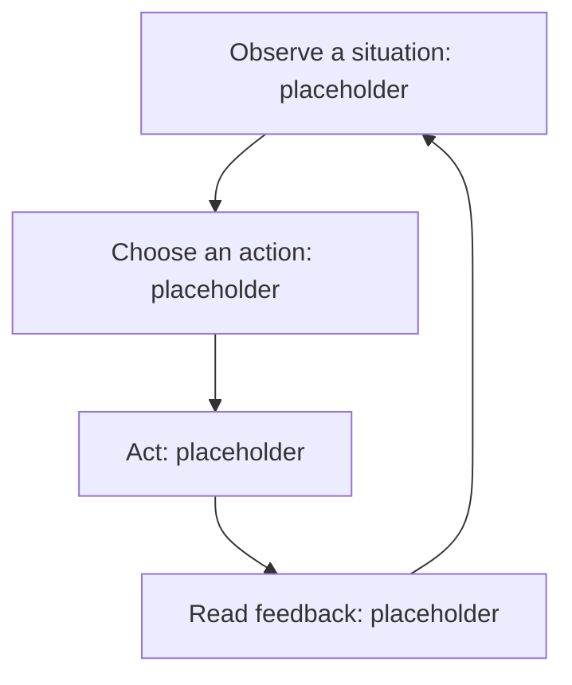

# 03 — Game loops
Status and sources: [record]. Mark speculative actions and conditional paths.

This is an illustrative skeleton, not a prescribed game loop.
Immediate repetition: [supported actions].
Longer loop: [only if known].
Unknown timing and transitions: [list].
