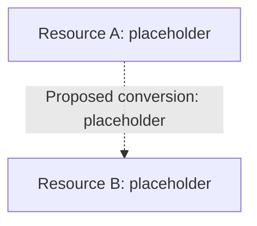

# 04 — Resource flow
Stage: [concept / first playable / implemented]. Sources: [record].
If no concrete mechanics exist, label the entire page a concept sketch or explain why no diagram can be supported.

Dashed relationship is speculative. Replace with real nouns and mechanics.
Explain occupancy, consumption, production, loss, and influence where relevant.
Questions to test: [feedback / redundancy / isolation / hub overload / victory or loss bottlenecks].
No diagram alone proves numerical balance.
